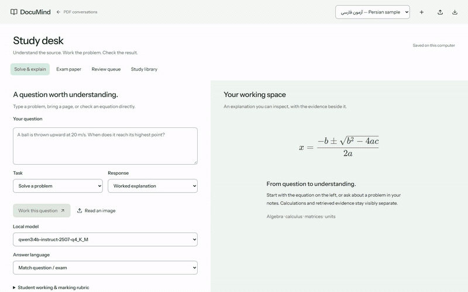

# DocuMind Local

**English** · [فارسی](README.fa.md)

An offline AI study workspace for your own PDFs. Upload study material, ask questions with clickable page references, or bring a separate homework/exam paper and work through its questions in the paper's language. Mathematical answers render with LaTeX, and supported calculations can be checked with a local symbolic calculator.

DocuMind runs on your computer: **Next.js + FastAPI + Ollama + Qdrant + SQLite**. The default installation uses local models and disables hosted AI providers. No paid chatbot subscription or hosted AI API key is required for the local workflow.

## See it working

[](https://raw.githubusercontent.com/ErphanRajai/DocuMind-Local/main/docs/media/documind-study-preview.mp4)

**[Play the full MP4 recording](https://raw.githubusercontent.com/ErphanRajai/DocuMind-Local/main/docs/media/documind-study-preview.mp4)** · [Download the recording](docs/media/documind-study-preview.mp4)

The animated preview plays directly in this README. The recording shows the current Next.js study desk using public synthetic Persian notes and questions, actual local model answers, rendered equations and an answer identifying missing information. It contains no private student documents. Automatic calculation is explicitly enabled for this known example; it is off by default.

## What you can do

- **Chat with PDFs:** index a document once, ask follow-up questions and inspect the original pages behind citations.
- **Study notes → question paper → answers:** choose study references separately from the exam. Process up to 20 numbered questions per run and review each result independently.
- **Use multiple languages:** match the question's language or select an answer language, including Persian. Persian/Arabic OCR, native digits and right-to-left answer rendering are supported.
- **Read and check mathematics:** automatic inline/display LaTeX, algebra, calculus, matrices and unit conversions through bounded SymPy/Pint tools. Review model-interpreted inputs before calculating.
- **Study actively:** worked explanations, hints, practice questions, review of your working, saved study items and a review queue.
- **Keep work locally:** saved workspaces, export/import, per-question results, progress, stop/retry controls and local document management.

## Install on Windows

1. [Download the project ZIP](https://github.com/ErphanRajai/DocuMind-Local/archive/refs/heads/main.zip), extract it and keep the folder in a permanent location. Alternatively:

   ```powershell
   git clone https://github.com/ErphanRajai/DocuMind-Local.git
   cd DocuMind-Local
   ```

2. Double-click **`Install_DocuMind.cmd`**. It checks Python, Node.js, Docker Desktop and Ollama; offers the official installers for missing prerequisites; downloads the models; builds the application; caches search assets; and verifies backend health. Complete any vendor, Windows permission, WSL or reboot prompts. Rerun the same installer after an interrupted setup.
3. Open **DocuMind Local** from the desktop shortcut, or double-click **`Start_DocuMind.bat`**.

The launcher opens the actual available local address. On this development machine that is `http://127.0.0.1:4400`; the configured default is port 4317, with fallbacks from 4400–4409. Use the address printed by your launcher.

This is a project-folder installer, not a standalone signed MSI. Closing the desktop window stops its app services. Existing PDFs, databases and older models are retained when setup is rerun.

### What gets downloaded?

| Component | Purpose |
| --- | --- |
| `qwen3:4b-instruct-2507-q4_K_M` | Default local text model for answers and explanations |
| `bge-m3` | Multilingual document-search embeddings; it does not write answers |
| Python/Node dependencies, Docker image and search caches | Run the interface, API, extraction and retrieval locally |

Allow at least **10 GB free**; the two models alone are approximately 3.7 GB. A practical starting point is **16 GB RAM** and a compatible GPU if available. These are planning recommendations, not tested minimum requirements; CPU generation is slower. The setup script targets Python 3.12 for new launcher environments and Node.js 22 or newer.

Optional vision models and the advanced Docling layout/formula parser are separate downloads. They are not silently installed by core setup.

## Offline means after setup

**Initial installation needs internet** to obtain software, models and container layers. Prepare these while international downloads are available. After successful setup, installed text/PDF workflows run on `localhost` without international internet, domestic internet or an online chatbot service.

The default `DOCUMIND_LOCAL_ONLY=1` blocks hosted providers and remote/cloud-delegating Ollama models. Fonts and retrieval assets are cached locally. Documents, extracted text and answers stay on this computer in the default workflow. This does not make the computer an air-gapped device or prevent other installed programs from using a network.

If something is missing, setup cannot download it during an internet outage. Updates and optional model installation also need downloads. A complete offline transfer/install bundle is not currently provided.

## Try the Persian sample

1. Upload [study-fa.pdf](docs/examples/persian/study-fa.pdf) to a workspace, then open **Study desk → Exam paper**.
2. Upload or select [exam-fa.pdf](docs/examples/persian/exam-fa.pdf) as the question paper.
3. Select the study PDF as evidence and leave the language on **Match question / exam**, or select **فارسی**.
4. Choose **Answer this paper**. Inspect each source and any interpreted calculator inputs.

The public example asks about energy, a water temperature, a quadratic equation and an unspecified laboratory name. The latest real-model sample passed 10 checks: three answered questions and one explicit **More information needed** result. That small sample is a workflow check, not an accuracy estimate for arbitrary exams.

## Accuracy and scope

- A citation identifies a retrieved PDF page; it does not prove every sentence is supported.
- A checked calculation verifies the supplied/interpreted mathematical inputs. OCR and interpretation can still be wrong. Arbitrary proofs, handwriting and diagrams are not guaranteed capabilities.
- Scan quality, subject matter, language, model and hardware affect results. Compare important answers with the original source or a teacher-checked solution.
- Default generation uses a budgeted 8,192-token context. Large documents are searched and processed in bounded portions; they are not all placed in one prompt.
- The app is designed for one local computer. It does not provide institutional accounts or a production multi-user deployment.
- The classic Streamlit UI is preserved as an optional fallback; the preview above shows the primary Next.js UI.

## Troubleshooting

Run a read-only readiness report:

```powershell
.\Install_DocuMind.cmd -CheckOnly
```

- **Docker unavailable:** start Docker Desktop, complete its first-run/WSL setup and wait for the engine before launching again.
- **Missing models or assets:** close DocuMind and rerun the installer while downloads are available.
- **Interface does not open:** use the exact URL printed by the launcher; do not assume a fixed port.
- **Need backend logs:** run `docker compose logs --tail 100 pdf_backend`. Do not publish logs containing your document text or credentials.

For manual configuration, use `.env.example` as a reference. Never replace an existing `.env` blindly or commit it to Git.

## Development and verification

| Location | Responsibility |
| --- | --- |
| `documind-web/` | Next.js/TypeScript interface, KaTeX and browser tests |
| `pdf-summarizer-backend/app/` | FastAPI, jobs, PDF/OCR, retrieval, study and calculation tools |
| `pdf-summarizer-backend/evaluation/` | Real-model, math, Persian and offline diagnostics |
| `pdf-summarizer-frontend/` | Preserved Streamlit fallback |
| `setup_documind.py`, `scripts/install-windows.ps1`, `launcher.py` | Setup and local service lifecycle |

With a development Python environment installed from `pdf-summarizer-backend/requirements-dev.txt`:

```powershell
cd pdf-summarizer-backend
python -m pytest tests -q
cd ../documind-web
npm ci
npm run test
npm run build
$env:DOCUMIND_TEST_URL='http://127.0.0.1:4400' # Use your running app's actual URL.
npm run test:e2e
```

Latest local verification: **217 backend tests, 61 frontend tests, seven browser tests and the production build passed**. Real-service checks additionally covered the Persian sample and six process-level offline checks. Many unit/browser tests use controlled substitutes; an OS-wide disconnected-machine test and clean-Windows prerequisite installation remain unverified.

Private PDFs, `.env`, databases, model storage, caches, logs and build output are excluded from Git. Back up local data and export important work before reinstalling or removing storage.

## Read the implementation

- [Local installation, multilingual exams and code walkthrough](docs/local-installation-and-persian.md)
- [Study and Solve: tools, data flow and tradeoffs](docs/study-and-solve.md)
- [PDF citations and evidence](docs/pdf-citations.md)
- [Backend processing and validation](docs/backend-processing.md)
- [Local model performance](docs/model-performance.md)
- [Next.js workbench](docs/workbench-upgrade.md)
- [Study verification results](docs/study-verification.md)

## License

[MIT](LICENSE). Dependencies and downloaded models retain their respective licences.
